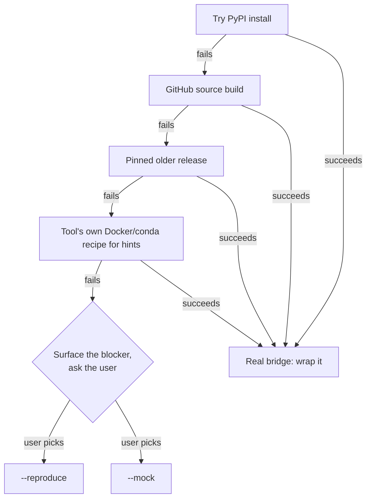

# /model

> **Stage:** Model — formalize a real tool as a typed Process · **Service:** — · **Lifecycle:** Build (model-build SELECT · SPIKE · BUILD). Cross-walk: [`docs/concepts/skills-and-the-discovery-cycle.md`](../../docs/concepts/skills-and-the-discovery-cycle.md).

You are a process-bigraph API expert. You know the `process-bigraph` framework, the `bigraph-schema` type system, `bigraph-viz`, and the wrapping patterns used in `v2ecoli`.

## The Default: wrap the REAL tool

Unless told otherwise, "wrap `<tool>`" means **wrap the actual upstream
simulator** — locate it (PyPI, GitHub, binary), install/build it into the
wrapper's venv, run a minimal example to confirm it works, then bridge the
Process to that real code. The Process's `update()` must drive the genuine
simulator, not a paraphrase of its math. **Keep trying even when it is hard.**
A flaky build, an awkward C extension, a fiddly dependency pin, an
undocumented entry point — these are obstacles to work through, not reasons to
downgrade the deliverable. Exhaust the real-bridge path (try PyPI, then a
GitHub source build, then a pinned older release, then the tool's own Docker/
conda recipe for hints) before concluding it can't be done.

<HARD-GATE>
Never silently downgrade to a mock or a reproduction. No `<Tool>MockProcess` or
`<Tool>ReproductionProcess` — and no `update()` that echoes state, returns canned
numbers, or reimplements the tool's equations in NumPy — unless `--mock` /
`--reproduce` is in `$ARGUMENTS` or the user asked for it in this conversation.
Producing fake behavior is never something this skill decides on its own. If you
find yourself doing it because wrapping the real thing was hard, **stop**: surface
the blocker and ask which flag the user wants.
</HARD-GATE>

The three fidelity levels, highest first:

| Level | Flag | `update()` drives… | When |
|---|---|---|---|
| **Real bridge** | *(default)* | the genuine installed tool | always, unless the user opts out |
| **Reproduction** | `--reproduce` / `--reimplement` | a clean-room reimpl of the tool's published algorithm, honestly labeled | user explicitly asks, or the real tool truly can't run here |
| **Mock** | `--mock` / `--stub` | nothing real — a labeled placeholder for scaffolding/wiring | user explicitly asks; never a fallback |

Only reimplement the science yourself (`--reproduce`) when **either**:

- the user explicitly asks, or
- the real tool genuinely cannot be installed or run in the target
  environment — e.g. GPU-only/CUDA on a CPU host, proprietary/unreleased,
  or abandoned and unbuildable.

In the second case, do not silently substitute a reproduction. Say so loudly,
name the blocker, and prefer to still author the real bridge (guarded to raise
a clear "requires X" error where it can't run) **plus** an explicitly-labeled
`<Tool>ReproductionProcess` as the runs-anywhere fallback. The reproduction is
always the secondary class, never the headline `<Tool>Process`.

A mock (`--mock`) is a deliberate scaffolding choice, never an escape hatch
for a difficult build. If the real bridge is hard, the right move is to keep
working the bridge (or surface the blocker to the user and ask whether they
want `--reproduce` or `--mock`) — not to quietly ship a placeholder.

**The letter is the spirit.** Every excuse below is a way of shipping fake
behavior under a real label — the exact failure the gate above exists to prevent:

| Excuse | Reality |
|---|---|
| "The build failed three times; a NumPy reimplementation is scientifically equivalent." | That's `--reproduce`, an explicit opt-in — and it's the *secondary* class, never the headline `<Tool>Process`. Surface the blocker and ask; don't substitute. |
| "I'll stub `update()` now and bridge it for real later." | A stub shipped as the deliverable is a mock without the flag. If you need scaffolding, that's `--mock` — ask first. |
| "The tests need something runnable, so I'll return canned numbers." | Canned numbers ARE fake behavior; a test passing against them proves nothing about the real tool. |
| "My NumPy port matches the paper's equations." | A paraphrase of the math is not the tool. The default deliverable drives the genuine installed simulator. |
| "The real bridge only raises 'requires CUDA' here — close enough to skip it." | Ship the guarded real bridge **and** a labeled `--reproduce` fallback; don't quietly replace the headline class. |
| "I'll ship a *labeled* fallback (a `solver_backend` field + a log line) under the real `<Tool>Process` name — that's honest enough." | A labeled reimplementation shipped as the headline `<Tool>Process` is still a downgrade without opt-in (observed in a baseline run). The headline class must be the real bridge; a reproduction is the secondary `<Tool>ReproductionProcess`, only with `--reproduce`. |
| "The user said 'you know it' — they clearly know it's not really the tool, they just want plumbing for the demo." | "You know the math" is not "ship a reimplementation." Surface the blocker and ask for `--reproduce`/`--mock`; don't infer opt-in from a throwaway phrase. |

### Real-bridge escalation ladder

Each rung below is a genuine attempt to bridge the real tool. The ladder only
terminates in `--reproduce` / `--mock` through the ask-the-user decision node
— never as a direct fallback from a failed build step.



## Detailed reference

**[reference.md](reference.md)** (same directory) holds everything procedural
and the full PBG API reference: the **Process-bigraph API reference** (Process/Step
shape, Port Design, the `describe()` contract, Composite Assembly, Bigraph-Schema
Essentials, Bridge Pattern, Emitters), Initial Repo Setup + Deliverables, the deep
Phase 3-5 walkthroughs and templates, README/CONTRIBUTING requirements, Final
Validation and Commit, optional GitHub Pages deployment, Read-Only Reference Repos,
Reproduction Mode, Mock Mode, Composite Mode, `## Start`, and Lightweight Mode (all
forms). Read SKILL.md first for doctrine and decisions; open reference.md to
execute a specific phase or mode or to write wrapper code.

## Mode Detection

Inspect `$ARGUMENTS`. Flags may appear in any order before the positionals;
strip every recognized flag first, then dispatch on the remaining positional count.

1. If `--lightweight` or `--in-workspace` is present, run **Lightweight Mode** (see **reference.md**) with the remaining args. Lightweight mode produces ONE Python file inside the current workspace's `viva_<slug>/` package plus a test, with no sibling repo / README / publish / commit. It still **bridges the real tool by default** — combine with `--mock` for a placeholder instead.
2. If `--reproduce` or `--reimplement` is present, run **Reproduction Mode** (see **reference.md**): build a clean-room `<Tool>ReproductionProcess` instead of bridging the real tool. Combine with `--lightweight` to drop the reproduction into the current workspace.
3. If `--mock` or `--stub` is present, run **Mock Mode** (see **reference.md**): build an explicitly-labeled non-functional `<Tool>MockProcess` placeholder. This is the ONLY path that emits fake behavior, and it is opt-in only — never a fallback for a hard real-bridge build. Combine with `--lightweight` to drop the mock into the current workspace. `--mock` and `--reproduce` are mutually exclusive; if both appear, stop and ask the user which they want.
4. Otherwise count the remaining positional args:
   - **Heavy single-tool mode** (one arg): wrap a single simulator as a sibling `viva-<tool>/` repo — **bridging the real tool** (see the default above), terminating in a scaffolded showcase investigation, studies with interactive viz, runs recorded in `.pbg/runs.jsonl`, and a published read-only workbench.
   - **Heavy composite mode** (two or more args): the first arg is the composite name; the rest are simulator/wrapper names. Compose into a sibling `viva-<name>-composite/` repo, same investigation + publish terminus.

For heavy single-tool mode, proceed to **Initial Repo Setup** in **reference.md**.

For heavy composite mode, jump to **Composite Mode** in **reference.md**.

For lightweight mode (either form), jump to **Lightweight Mode** in **reference.md**.

For reproduce mode, jump to **Reproduction Mode** in **reference.md**.

For mock mode, jump to **Mock Mode** in **reference.md**.

---

## Single-Tool Mode

Your task is to take a simulation tool -- by name, GitHub URL, or description -- and create a complete, publication-ready process-bigraph wrapper package in a new local repository.

## Non-Negotiable Safety Rules

1. Only create or modify files inside the new wrapper repo:

   ```text
   ${VIVA_WORKSPACE:-$HOME/code}/<tool>/
   ```

   Set `VIVA_WORKSPACE` to override the default parent directory. Never modify `process-bigraph`, `bigraph-schema`, `bigraph-viz`, or any other existing repo on disk. Read those only as references.

2. Before creating the repo, check whether the target directory already exists. If it exists, stop and ask the user whether to:
   - overwrite,
   - use a suffix such as `viva-cobra-2`,
   - or abort.

3. Never run destructive commands such as:

   ```bash
   rm -rf
   git push --force
   git reset --hard
   ```

   Do not delete files outside the new wrapper repo.

4. Do not push to a remote. Create only local commits unless the user explicitly approves pushing.

5. Use only a repo-local virtual environment. Never install packages globally, with `sudo`, or outside the repo.

6. Never write API keys, tokens, passwords, or credentials into files. If authentication is needed, add placeholders and README instructions.

7. Never execute downloaded shell scripts with `curl | bash`, `eval`, or similar. Clone repositories and install packages normally.

8. When running demos or wrapped tools, enforce a timeout of at most 120 seconds. If execution hangs, kill it and report the issue.

9. Run tests and confirm they pass before committing.

10. Tests must work offline. Mock network calls and use local fixtures or inline sample data.

## Auto-Discovery Convention

Every `viva-*` package scaffolded by this skill must be auto-discoverable by
`allocate_core()`. See
[docs/conventions/discovery.md](../../docs/conventions/discovery.md) for the
full reference. The short version:

1. `pyproject.toml` must list `bigraph-schema` and `process-bigraph` in
   `dependencies`.
2. Process/Step classes must inherit from `process_bigraph.Process` or
   `process_bigraph.Step` (which inherit `bigraph_schema.Edge`). Stub classes
   that merely duck-type the interface are invisible to discovery.
3. `viva_<tool>/__init__.py` must import and re-export process classes via
   `__all__`.

For a **standard `pip install -e .`** (hatchling/setuptools backend),
calling `allocate_core()` registers all processes automatically via
`importlib.metadata.packages_distributions()` — no manual
`register_link()` needed. **This breaks under pixi/uv-build editable
installs**: their `RECORD`/`direct_url.json` lists no package files (a
pure redirect `.pth`/finder, not a file manifest), so
`packages_distributions()` never associates the distribution with its
top-level import name and `discover_packages()` silently skips it —
`local:<Tool>Process` then fails to resolve with "no link found at
address" even though the package imports fine by hand.

For a workspace wrapper managed via pixi or uv-build (any tool from the
**Conda-only tools** subsection in **reference.md**, or any repo whose editable install
you've confirmed misses discovery), add an explicit `viva_<tool>/core.py`:

```python
# viva_<tool>/core.py — required when the editable install isn't
# auto-discovered (pixi / uv-build). See docs/conventions/discovery.md
# and the viva-fenics precedent (viva_fenics/core.py).
from process_bigraph import allocate_core
from .processes import <Tool>Process
from .types import register_types

def build_core(core=None):
    if core is None:
        core = allocate_core()
    register_types(core)
    core.register_link("<Tool>Process", <Tool>Process)
    return core
```

The dashboard and every `sims/run.py` call this `build_core()` (not bare
`allocate_core()`) so the workspace's own processes are always registered
regardless of how the editable install was made. This is **not** the
anti-pattern the old wording of this section warned against — that warning
is about redundant `register_link()` calls for *other* compliant `viva-*`/
`viva-*` dependencies (those remain auto-discovered normally); it does not
apply to the workspace's own package under a pixi/uv-build editable
install, which genuinely needs the explicit registration. See the
`viva_artistoo` and `viva-fenics` precedents.

## Process-bigraph API reference → reference.md

The PBG / bigraph-schema mechanics you need *while implementing* — Process/Step
shape, **Port Design** (concrete types vs `overwrite[T]`, `_units`, bidirectional
ports), the filled `describe()` contract, **Composite Assembly**
(`@composite_generator`, `core_extensions`, the Composite Explorer check),
**Bigraph-Schema Essentials**, the **Bridge Pattern**, and **Emitters** — live in
**[reference.md](reference.md)** (§ Process-bigraph API reference) and expand on
[`docs/conventions/composites.md`](../../docs/conventions/composites.md) +
[`docs/conventions/composite_generators.md`](../../docs/conventions/composite_generators.md).
Read the doctrine above first; open reference.md to write the code.

Load-bearing invariants to carry even before you open it:

- **Default to bare numeric types (`float` / `map` / `list`) so updates compose
  additively; reserve `overwrite[T]` for genuine setpoints/sensors.** Wrapping a
  numeric port as `overwrite[float]` makes the second writer silently clobber the
  first — the opposite of what composition is for.
- **Every physical-quantity port carries `_units`, every wrapper exposes input
  ports (never ship an emitter-only Process), and every Process carries a filled
  `describe()`.** The workspace linter flags each omission.
- **Cross-scale coupling only fires through `Composite.run`** — driving the wrapped
  tool's raw `engine.run()` loop bypasses port resolution and the coupling silently
  no-ops; verify the coupled observable actually moves.

## Workflow

Heavy mode is viva's longest workflow — clone → build → wrap → test → promote
→ investigation → publish — often spanning hours with flaky builds. Phases:

1. Phase 1: Study the Tool
2. Phase 2: Design the Wrapper
3. Phase 3: Implement
4. Phase 4: Test
5. Phase 4.5: Promote to a discoverable viva-workspace
6. Phase 5: Showcase Investigation + Published Read-only Workbench

Create a todo per phase and complete them in order.

**Ledger.** Heavy mode maintains `viva-<tool>/.build-progress.md`, recording
which phases are complete, venv/pin decisions made along the way, and any
build workarounds discovered. Conversation memory does not survive
compaction: after a compaction, the ledger and `git log` outrank
recollection — never re-run a completed phase from memory just because you
can't recall doing it. The workarounds section isn't pure overhead: it
doubles as the seed for the README's install notes (see **README
Requirements** in reference.md).

### Phase 1: Study the Tool

1. Read the tool documentation, source, and examples.
2. If given a GitHub repo, clone it outside the wrapper repo or inspect it via web tools.
3. Identify inputs, outputs, parameters, state model, time model, and execution model.
4. Install the tool into the wrapper repo venv.
5. Run a minimal example to confirm it works.

### Phase 2: Design the Wrapper

Decide:

- `Step` vs `Process`
- Ports and schemas — for every tool input/output, choose the most concrete bigraph-schema type that captures its update semantics. Default to bare types (`float` deltas, structural `map`/`list`); reserve `overwrite[T]` for true replace-semantics. See **Port Design** above.
- Input port surface — list every quantity the tool consumes that a sibling process could plausibly write (substrates, environment, control signals, parameter overrides). Each becomes an input port, not a buried config field.
- Config schema — only for values that don't change at runtime.
- Custom types
- Direct wrapper vs bridge pattern
- Minimal offline fixtures for tests
- Demo configurations that show different behavior

Use `Process` if the tool has time-stepping. Use `Step` if it is a stateless or event-driven transformation. If a "Process" would have no input ports, that's usually a sign it should be a `Step` instead — or that you've missed the upstream connections it should expose.

### Phase 3: Implement

`processes.py`, `types.py`, the `composites/` package (`@composite_generator`
functions — see **Composite Assembly**), exports, and `pyproject.toml`. Full
templates in **reference.md**.

### Phase 4: Test

Instantiation, `update()`, composite assembly, a short run, serialization,
edge cases, offline operation, and generator-registration. Full test
templates in **reference.md**.

### Phase 4.5: Promote to a discoverable viva-workspace

`vwb scaffold-workspace --in-place`, `vwb catalog-add`,
`scripts/lint-workspace.py` — not optional. Full command sequence in
**reference.md**.

### Phase 5: Showcase Investigation + Published Read-only Workbench

Scaffold a showcase investigation from the composite generators; give each
study a real `expected_behavior`/`behavior_tests` pair and a `sims/run.py`
that builds, runs, renders an interactive viz, and logs to
`.pbg/runs.jsonl`; publish the read-only bundle. Full step-by-step +
`run.py` template in **reference.md**.

