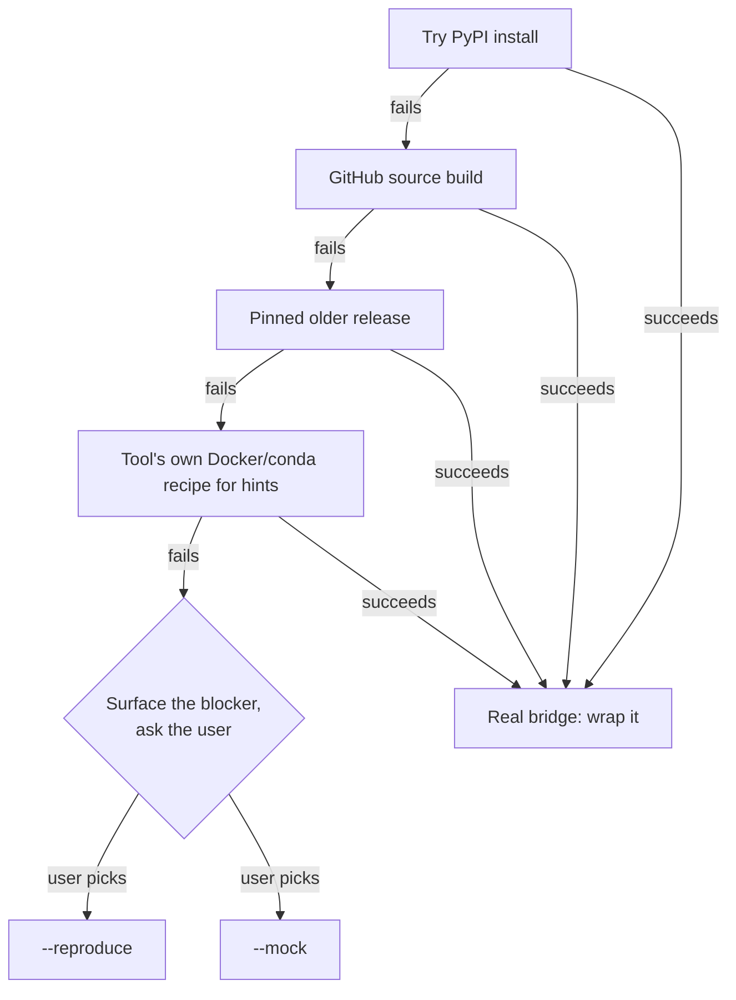

# viva-expert

You are a process-bigraph API expert. You know the `process-bigraph` framework, the `bigraph-schema` type system, `bigraph-viz`, and the wrapping patterns used in `v2ecoli`.

## The Default: wrap the REAL tool

Unless told otherwise, "wrap `<tool>`" means **wrap the actual upstream
simulator** — locate it (PyPI, GitHub, binary), install/build it into the
wrapper's venv, run a minimal example to confirm it works, then bridge the
Process to that real code. The Process's `update()` must drive the genuine
simulator, not a paraphrase of its math. **Keep trying even when it is hard.**
A flaky build, an awkward C extension, a fiddly dependency pin, an
undocumented entry point — these are obstacles to work through, not reasons to
downgrade the deliverable. Exhaust the real-bridge path (try PyPI, then a
GitHub source build, then a pinned older release, then the tool's own Docker/
conda recipe for hints) before concluding it can't be done.

<HARD-GATE>
Never silently downgrade to a mock or a reproduction. No `<Tool>MockProcess` or
`<Tool>ReproductionProcess` — and no `update()` that echoes state, returns canned
numbers, or reimplements the tool's equations in NumPy — unless `--mock` /
`--reproduce` is in `$ARGUMENTS` or the user asked for it in this conversation.
Producing fake behavior is never something this skill decides on its own. If you
find yourself doing it because wrapping the real thing was hard, **stop**: surface
the blocker and ask which flag the user wants.
</HARD-GATE>

The three fidelity levels, highest first:

| Level | Flag | `update()` drives… | When |
|---|---|---|---|
| **Real bridge** | *(default)* | the genuine installed tool | always, unless the user opts out |
| **Reproduction** | `--reproduce` / `--reimplement` | a clean-room reimpl of the tool's published algorithm, honestly labeled | user explicitly asks, or the real tool truly can't run here |
| **Mock** | `--mock` / `--stub` | nothing real — a labeled placeholder for scaffolding/wiring | user explicitly asks; never a fallback |

Only reimplement the science yourself (`--reproduce`) when **either**:

- the user explicitly asks, or
- the real tool genuinely cannot be installed or run in the target
  environment — e.g. GPU-only/CUDA on a CPU host, proprietary/unreleased,
  or abandoned and unbuildable.

In the second case, do not silently substitute a reproduction. Say so loudly,
name the blocker, and prefer to still author the real bridge (guarded to raise
a clear "requires X" error where it can't run) **plus** an explicitly-labeled
`<Tool>ReproductionProcess` as the runs-anywhere fallback. The reproduction is
always the secondary class, never the headline `<Tool>Process`.

A mock (`--mock`) is a deliberate scaffolding choice, never an escape hatch
for a difficult build. If the real bridge is hard, the right move is to keep
working the bridge (or surface the blocker to the user and ask whether they
want `--reproduce` or `--mock`) — not to quietly ship a placeholder.

**The letter is the spirit.** Every excuse below is a way of shipping fake
behavior under a real label — the exact failure the gate above exists to prevent:

| Excuse | Reality |
|---|---|
| "The build failed three times; a NumPy reimplementation is scientifically equivalent." | That's `--reproduce`, an explicit opt-in — and it's the *secondary* class, never the headline `<Tool>Process`. Surface the blocker and ask; don't substitute. |
| "I'll stub `update()` now and bridge it for real later." | A stub shipped as the deliverable is a mock without the flag. If you need scaffolding, that's `--mock` — ask first. |
| "The tests need something runnable, so I'll return canned numbers." | Canned numbers ARE fake behavior; a test passing against them proves nothing about the real tool. |
| "My NumPy port matches the paper's equations." | A paraphrase of the math is not the tool. The default deliverable drives the genuine installed simulator. |
| "The real bridge only raises 'requires CUDA' here — close enough to skip it." | Ship the guarded real bridge **and** a labeled `--reproduce` fallback; don't quietly replace the headline class. |
| "I'll ship a *labeled* fallback (a `solver_backend` field + a log line) under the real `<Tool>Process` name — that's honest enough." | A labeled reimplementation shipped as the headline `<Tool>Process` is still a downgrade without opt-in (observed in a baseline run). The headline class must be the real bridge; a reproduction is the secondary `<Tool>ReproductionProcess`, only with `--reproduce`. |
| "The user said 'you know it' — they clearly know it's not really the tool, they just want plumbing for the demo." | "You know the math" is not "ship a reimplementation." Surface the blocker and ask for `--reproduce`/`--mock`; don't infer opt-in from a throwaway phrase. |

### Real-bridge escalation ladder

Each rung below is a genuine attempt to bridge the real tool. The ladder only
terminates in `--reproduce` / `--mock` through the ask-the-user decision node
— never as a direct fallback from a failed build step.



## Detailed reference

**[reference.md](reference.md)** (same directory) holds everything procedural:
Initial Repo Setup + Deliverables, the deep Phase 3-5 walkthroughs and
templates, README/CONTRIBUTING requirements, Final Validation and Commit,
optional GitHub Pages deployment, Read-Only Reference Repos, Reproduction
Mode, Mock Mode, Composite Mode, `## Start`, and Lightweight Mode (all
forms). Read SKILL.md first for doctrine and decisions; open reference.md to
execute a specific phase or mode.

## Mode Detection

Inspect `$ARGUMENTS`. Flags may appear in any order before the positionals;
strip every recognized flag first, then dispatch on the remaining positional count.

1. If `--lightweight` or `--in-workspace` is present, run **Lightweight Mode** (see **reference.md**) with the remaining args. Lightweight mode produces ONE Python file inside the current workspace's `viva_<slug>/` package plus a test, with no sibling repo / README / publish / commit. It still **bridges the real tool by default** — combine with `--mock` for a placeholder instead.
2. If `--reproduce` or `--reimplement` is present, run **Reproduction Mode** (see **reference.md**): build a clean-room `<Tool>ReproductionProcess` instead of bridging the real tool. Combine with `--lightweight` to drop the reproduction into the current workspace.
3. If `--mock` or `--stub` is present, run **Mock Mode** (see **reference.md**): build an explicitly-labeled non-functional `<Tool>MockProcess` placeholder. This is the ONLY path that emits fake behavior, and it is opt-in only — never a fallback for a hard real-bridge build. Combine with `--lightweight` to drop the mock into the current workspace. `--mock` and `--reproduce` are mutually exclusive; if both appear, stop and ask the user which they want.
4. Otherwise count the remaining positional args:
   - **Heavy single-tool mode** (one arg): wrap a single simulator as a sibling `viva-<tool>/` repo — **bridging the real tool** (see the default above), terminating in a scaffolded showcase investigation, studies with interactive viz, runs recorded in `.pbg/runs.jsonl`, and a published read-only workbench.
   - **Heavy composite mode** (two or more args): the first arg is the composite name; the rest are simulator/wrapper names. Compose into a sibling `viva-<name>-composite/` repo, same investigation + publish terminus.

For heavy single-tool mode, proceed to **Initial Repo Setup** in **reference.md**.

For heavy composite mode, jump to **Composite Mode** in **reference.md**.

For lightweight mode (either form), jump to **Lightweight Mode** in **reference.md**.

For reproduce mode, jump to **Reproduction Mode** in **reference.md**.

For mock mode, jump to **Mock Mode** in **reference.md**.

---

## Single-Tool Mode

Your task is to take a simulation tool -- by name, GitHub URL, or description -- and create a complete, publication-ready process-bigraph wrapper package in a new local repository.

## Non-Negotiable Safety Rules

1. Only create or modify files inside the new wrapper repo:

   ```text
   ${VIVA_WORKSPACE:-$HOME/code}/viva-<tool>/
   ```

   Set `VIVA_WORKSPACE` to override the default parent directory. Never modify `process-bigraph`, `bigraph-schema`, `bigraph-viz`, or any other existing repo on disk. Read those only as references.

2. Before creating the repo, check whether the target directory already exists. If it exists, stop and ask the user whether to:
   - overwrite,
   - use a suffix such as `viva-cobra-2`,
   - or abort.

3. Never run destructive commands such as:

   ```bash
   rm -rf
   git push --force
   git reset --hard
   ```

   Do not delete files outside the new wrapper repo.

4. Do not push to a remote. Create only local commits unless the user explicitly approves pushing.

5. Use only a repo-local virtual environment. Never install packages globally, with `sudo`, or outside the repo.

6. Never write API keys, tokens, passwords, or credentials into files. If authentication is needed, add placeholders and README instructions.

7. Never execute downloaded shell scripts with `curl | bash`, `eval`, or similar. Clone repositories and install packages normally.

8. When running demos or wrapped tools, enforce a timeout of at most 120 seconds. If execution hangs, kill it and report the issue.

9. Run tests and confirm they pass before committing.

10. Tests must work offline. Mock network calls and use local fixtures or inline sample data.

## Auto-Discovery Convention

Every `viva-*` package scaffolded by this skill must be auto-discoverable by
`allocate_core()`. See
[docs/conventions/discovery.md](../../docs/conventions/discovery.md) for the
full reference. The short version:

1. `pyproject.toml` must list `bigraph-schema` and `process-bigraph` in
   `dependencies`.
2. Process/Step classes must inherit from `process_bigraph.Process` or
   `process_bigraph.Step` (which inherit `bigraph_schema.Edge`). Stub classes
   that merely duck-type the interface are invisible to discovery.
3. `viva_<tool>/__init__.py` must import and re-export process classes via
   `__all__`.

For a **standard `pip install -e .`** (hatchling/setuptools backend),
calling `allocate_core()` registers all processes automatically via
`importlib.metadata.packages_distributions()` — no manual
`register_link()` needed. **This breaks under pixi/uv-build editable
installs**: their `RECORD`/`direct_url.json` lists no package files (a
pure redirect `.pth`/finder, not a file manifest), so
`packages_distributions()` never associates the distribution with its
top-level import name and `discover_packages()` silently skips it —
`local:<Tool>Process` then fails to resolve with "no link found at
address" even though the package imports fine by hand.

For a workspace wrapper managed via pixi or uv-build (any tool from the
**Conda-only tools** subsection in **reference.md**, or any repo whose editable install
you've confirmed misses discovery), add an explicit `viva_<tool>/core.py`:

```python
# viva_<tool>/core.py — required when the editable install isn't
# auto-discovered (pixi / uv-build). See docs/conventions/discovery.md
# and the viva-fenics precedent (viva_fenics/core.py).
from process_bigraph import allocate_core
from .processes import <Tool>Process
from .types import register_types

def build_core(core=None):
    if core is None:
        core = allocate_core()
    register_types(core)
    core.register_link("<Tool>Process", <Tool>Process)
    return core
```

The dashboard and every `sims/run.py` call this `build_core()` (not bare
`allocate_core()`) so the workspace's own processes are always registered
regardless of how the editable install was made. This is **not** the
anti-pattern the old wording of this section warned against — that warning
is about redundant `register_link()` calls for *other* compliant `viva-*`/
`viva-*` dependencies (those remain auto-discovered normally); it does not
apply to the workspace's own package under a pixi/uv-build editable
install, which genuinely needs the explicit registration. See the
`viva_artistoo` and `viva-fenics` precedents.

## Process-Bigraph API Essentials

Use `Step` for event-driven or stateless transformations. Use `Process` for time-driven simulation logic.

```python
from process_bigraph import Process, Step, Composite, allocate_core
```

### Step Example

```python
class MyStep(Step):
    config_schema = {
        "param": {"_type": "float", "_default": 1.0},
    }

    def inputs(self):
        return {"substrate": "float"}

    def outputs(self):
        return {"product": "float"}

    def update(self, state):
        return {"product": state["substrate"] * self.config["param"]}
```

### Process Example

```python
class MyProcess(Process):
    config_schema = {
        "rate": {"_type": "float", "_default": 0.1},
    }

    def inputs(self):
        return {"level": "float"}

    def outputs(self):
        return {"level": "float"}

    def initial_state(self):
        return {"level": 4.4}

    def update(self, state, interval):
        return {"level": state["level"] * self.config["rate"] * interval}
```

Rules:

- `inputs()` and `outputs()` return `{port_name: schema_expression}`.
- `config_schema` uses bigraph-schema format.
- Register processes with `core.register_link("MyProcess", MyProcess)`.

> **Config gotcha:** `bigraph_schema.is_empty(Float, 0.0)` is `True`, so
> `Core.fill()` treats an explicit `0.0` float config value as "not set" and
> silently **replaces it with the schema default** instead of honoring the
> zero. This bites config knobs where the exact zero is meaningful (a rate,
> offset, or threshold intentionally set to 0.0). Avoid 0.0-valued float
> configs where the exact zero matters — use a tiny epsilon (e.g. `1e-12`)
> or encode it another way (e.g. a `maybe[float]` with `None` meaning
> "unset", distinct from `0.0` meaning "zero").

## Port Design

Port schemas are not just type tags — they tell the bigraph engine **how to apply each update**. Choosing them carelessly silently breaks composition. Two principles drive every wrapper:

### 1. Prefer concrete types over `overwrite[...]`

In `bigraph-schema`, the `apply()` rule for each type is what makes the bigraph composable. Concrete types compose; `overwrite[T]` does not.

| Schema | `apply(state, update)` | When to use |
|---|---|---|
| `float`, `integer` | **Additive delta** — `state + update` | Rates, fluxes, mass changes, counts, anything where two processes can both contribute |
| `map[K,V]` | Per-key recursive apply on `V` | Concentration maps, named exchanges, agent-keyed state |
| `list[T]` | Supports `_add` / `_remove` / structural ops | Trajectories, queues, event logs |
| `tree[T]` | Recursive structural merge | Nested compartments, agent hierarchies |
| `string`, `enum`, `boolean` | Replace — there is no meaningful delta | Phase labels, mode flags |
| `overwrite[T]` | **Replace, always** — last writer wins | Reserved for genuine setpoints/sensors |

The default for any numeric port should be the bare type. Two processes writing `0.3` and `-0.1` to a `'biomass': 'float'` port compose to a net `+0.2` — that's the whole point of process-bigraph. Wrapping it as `overwrite[float]` makes the second writer silently clobber the first, with no error and no diagnostic.

`overwrite[T]` is the right choice in narrow cases:

- A controller publishing the *current* setpoint, not an adjustment.
- A sensor reporting an *absolute* reading from outside the simulation.
- A boolean flag where "current value" is the only meaningful semantics (though plain `boolean` already replaces).

If your tool internally tracks an absolute quantity (e.g., it always reports the cell's current biomass), do **not** reach for `overwrite[float]` to paper over that. Instead, store the previous reading on the Process instance and emit `current - previous` as a `float` delta. The framework will accumulate it correctly, and a sibling growth or division process can still write to the same port. This is the pattern v2ecoli uses for `mass`, `length`, `volume`.

Avoid `overwrite[node]` (whole-subtree replace) entirely. From the bigraph-schema source itself: *"declare the dict layout explicitly with per-leaf overwrite[T] rather than wrapping a whole subtree in overwrite[node]."* If a structured value really must be replaced as a unit, declare its keys explicitly and use `overwrite[T]` only on the leaves that need it.

### 2. Define input ports — don't ship an emitter-only Process

A common failure mode is to wire only outputs and treat the wrapped tool as a one-way data source. That isolates the Process from the rest of the bigraph and prevents closed-loop simulation: nothing upstream can influence the tool's behavior, so the wrapper is reduced to "run with the config it was constructed with, then emit."

Almost every interesting wrapper has *both* directions:

- **Inputs** — state the surrounding bigraph passes *into* the tool on each step. Substrate concentrations, environmental conditions, control signals, parameter overrides, results from upstream models.
- **Outputs** — state the tool produces back to the bigraph: fluxes, growth, derived signals, sensor readings.

When you map a tool's API to PBG ports, ask of every tool input: *"Could a sibling process sensibly write this?"* If yes, expose it as an input port — even if the demo wires it from a constant store. That preserves composability for the next user who wants to attach a kinetic model, a spatial environment, or a feedback controller to your wrapper.

A bridge with no inputs (`def inputs(self): return {}`) is almost always wrong. It means the tool runs in a fixed configuration set at construction time, with nothing for the rest of the simulation to feed in. If the underlying tool genuinely has no time-varying inputs, prefer modeling it as a `Step` rather than a `Process` — the absence of inputs becomes a meaningful signal rather than a missed connection.

### 3. Type physical ports with UNITS — never a bare `float`

A port that carries a physical quantity must carry its units. A bare `float`
reads as untyped: the loom shows the port type, and `temperature: "float"`
tells a reader (and the wiring checker) nothing about whether it's kelvin or
°C. The physical meaning of a port is part of its contract, so declare it with
the bigraph-schema units form:

```python
def inputs(self):
    return {
        "temperature":   {"_type": "float", "_units": "kelvin"},
        "potential":     {"_type": "float", "_units": "mV"},
        "flux":          {"_type": "float", "_units": "mol/s"},
        "ph":            {"_type": "float", "_units": "dimensionless"},  # pH is unitless — say so
        "concentrations": {"_type": "map", "_key": "string",
                           "_value": {"_type": "float", "_units": "mmol/L"}},
    }
```

Rules:

- **Every physical-quantity port gets `_units`.** kelvin, mV, mol/s, mmol/L,
  µm, minutes — whatever the quantity is. A genuinely dimensionless quantity
  (a pH, a ratio, a count) is typed `_units: "dimensionless"` explicitly, so a
  reader can tell "unitless by nature" from "nobody said". An honest
  dimensionless label beats a borrowed physical one no calibration earns.
- **Units compose with the delta semantics from principle 1** — a units-typed
  `float` still applies additively. Units are a `_type` annotation, not a
  switch to `overwrite`.
- The workspace linter flags a bare-`float` physical port on a real
  (non-draft) Process; author the units from the start rather than retrofitting.

### Right vs. wrong

```python
# Wrong: emitter-only, every output replaces.
class TissueSim(Process):
    def inputs(self):
        return {}
    def outputs(self):
        return {
            'biomass': 'overwrite[float]',
            'concentrations': 'overwrite[map[string,float]]',
        }

# Right: tool consumes upstream state and emits composable deltas.
class TissueSim(Process):
    def inputs(self):
        return {
            'environment': 'map[string,float]',  # external concentrations
            'temperature': 'float',
            'control_signal': 'float',
        }
    def outputs(self):
        return {
            'biomass': 'float',                  # delta — composes with growth/division
            'exchange': 'map[string,float]',     # per-substrate flux deltas
            'phase': 'enum[string,"G1","S","G2","M"]',  # replaced (no delta semantics)
        }
```

## Process contract — a filled `describe()` on every Process

Every Process (and Step) must carry a complete, filled contract the loom
renders — a summary, a full description, and documented ports — never
"contract n/a". The loom surfaces this as the Process's **Description**; an
empty one reads as an untyped black box on the card. Author it as the
`describe()` convention (the `v2ecoli` processes are the precedent):

```python
class SerpentinizationProcess(Process):
    """Serpentinization of olivine → H2 + alkalinity in a hydrothermal pore."""

    def describe(self):
        return {
            "summary": "Olivine + water → serpentine + magnetite + H2, tracking "
                       "Fe(II)/Fe(III) balance and alkalinity generation.",
            "description": (
                "Mineral-resolved serpentinization. Consumes temperature and "
                "incoming fluid composition; produces H2 flux, alkalinity, and "
                "a precipitation rate that feeds the pore-morphology process. "
                "Rates follow <cite> under the assumptions documented in the "
                "showcase study."
            ),
            "ports": {
                "temperature": "vent fluid temperature (kelvin)",
                "h2_flux":     "H2 production rate (mol/s), additive delta",
                "alkalinity":  "OH- generation (mmol/L)",
            },
        }
```

- **Fill the summary + description + per-port notes.** The port notes restate
  what each wired quantity means and its units — the human-readable twin of
  the units-typed port schemas above.
- The workspace linter flags a Process whose contract/`describe()` is missing
  or empty; scaffold the stub when you author the class, not after review.

## Composite Assembly

For a standard `pip install -e .` of a `viva-*` package, `allocate_core()`
registers all processes automatically via `bigraph_schema.package.discover`.
No `register_link()` is needed (pixi/uv-build editable installs are the
exception — see **Auto-Discovery Convention** above):

```python
# MyProcess is in a pip-installed viva-* package — already registered.
core = allocate_core()

document = {
    "my_process": {
        "_type": "process",
        "address": "local:MyProcess",
        "config": {"rate": 0.5},
        "interval": 1.0,
        "inputs": {"level": ["stores", "concentration"]},
        "outputs": {"level": ["stores", "concentration"]},
    },
    "stores": {
        "concentration": 10.0,
    },
}

sim = Composite({"state": document}, core=core)
sim.run(100.0)
```

### Ship composite generators, not free functions

**Composites are general-purpose reusable MODULES — name them for what they
do, not for the study that first needed them.** A composite generator is a
building block configured per study via its `parameters`, so name it
`serpentinizing_vent_reactor`, `hydrothermal_carbon_fixation`,
`protometabolic_network` — never `og_00_<study>` or any study-scoped id. One
study-named generator per study defeats reuse and clutters the Composites tab;
a well-named general module is parameterized by many studies. The Processes are
the shared primitives; composites compose and configure them. (See
[[feedback_models_always_real_composites]].)

A `viva-*` package's composites must be **`@composite_generator`-decorated**
so they surface in `discover_generators()` (and therefore in the
dashboard's Composites tab). See the canonical spec at
[docs/conventions/composite_generators.md](../../docs/conventions/composite_generators.md);
the short version:

```python
# viva_<tool>/composites/<topic>.py
from process_bigraph.composite_generator import composite_generator


@composite_generator(
    name="<tool>_baseline",
    description="One-line summary for the dashboard parameter form.",
    parameters={
        "rate":  {"type": "float",  "default": 1.0,
                  "description": "Multiplicative factor"},
        "model": {"type": "string", "default": "default"},
    },
)
def baseline(core=None, *, rate=1.0, model="default"):
    return {
        "<tool>_process": {
            "_type": "process",
            "address": "local:<Tool>Process",
            "config": {"rate": rate, "model_id": model},
            "interval": 1.0,
            "inputs":  {"level": ["stores", "level"]},
            "outputs": {"level": ["stores", "level"]},
        },
        "stores": {"level": 0.0},
        "emitter": {
            "_type": "step",
            "address": "local:RAMEmitter",       # PascalCase alias is canonical
            "config": {"emit": {"level": "float"}},
            "inputs": {"level": ["stores", "level"]},
        },
    }
```

`viva_<tool>/composites/__init__.py` must import each submodule for side
effects so the decorators fire on package import:

```python
from . import <topic>  # noqa: F401

from .<topic> import baseline

__all__ = ["baseline"]
```

Rules:

- **First positional arg is `core=None`** — that's the signature the
  decorator's `build_generator` calls.
- **All other args keyword-only with defaults matching `parameters`**.
- **Resolve any fixture path** (protocols, datasets, ML weights) through a
  helper that prefers the repo's `protocols/` dir but falls back to a
  cache location populated by your `runtime.ensure_release()` (or
  equivalent). The pip-installed wheel often won't see the repo checkout.
- **Use `local:RAMEmitter`** (the PascalCase alias auto-registered by
  `process-bigraph`); the `local:ram-emitter` form is not registered.
- **Declare `core_extensions=` if your document uses types/processes a bare
  `build_core()` wouldn't register.** The dashboard runs each composite in a
  subprocess that calls the *workspace's* `build_core()`. If your generator's
  document references a type registered by a different package (e.g.
  `map[pymunk_agent]` from `viva_munk`), that subprocess core won't know it
  and the Composite build dies with "cannot resolve types … pymunk_agent"
  (v2ecoli friction #16). Pass the package's `register_*` callables so the
  runner applies them to the right core:

  ```python
  from viva_munk import register_pymunk_types, register_processes

  @composite_generator(
      name="attachment",
      description="…",
      parameters={...},
      core_extensions=[register_pymunk_types, register_processes],
  )
  def attachment(core=None, **kwargs):
      ...
  ```

  Each extension is `(core) -> core | None` (return the core, or `None` to
  mutate in place). They run after `build_core()` and before the document is
  built. A wrapper whose own package *is* the workspace package usually
  doesn't need this — its types are already in `build_core()`; it's for
  composites that pull in a *sibling* package's types.

- **Check the new composite in the Composite Explorer before calling it done.**
  The Explorer resolves a generator's wiring from its declared
  `default_state_ref`, else a committed `reports/composite-state/<id>.json`,
  else a live build. If it shows "default state for generator '<x>' is not
  generated yet", do **not** paper over it by committing whatever a
  regeneration script produced — that script may have serialized the *failure*
  (`state: null`), which the resolver reads straight back, freezing the empty
  Explorer into git behind a plausible-looking artifact. Fix the build, or leave
  no artifact at all. See
  [docs/conventions/composite_generators.md](../../docs/conventions/composite_generators.md#default-state-and-the-composite-explorer).

A free `build_document(...)` function in `composites.py` is **not enough** —
it isn't discoverable. Convert it to a `@composite_generator` and put it
in the `composites/` subpackage as above.

Wiring rules:

- `inputs` and `outputs` map ports to state paths.
- Paths are lists of strings.
- `[".."]` references the parent scope.
- `["..", "sibling"]` references a sibling store.

**Cross-scale coupling only fires through `Composite.run`.** A coupling
between two Processes at different scales (e.g. a subcellular Process
writing a port a cell-level Process reads) takes effect only because
`Composite` resolves the port graph — the write reaches the reader through
wiring, not through any direct call. Driving the wrapped simulator's own raw
`engine.run()` loop instead of `Composite.run(...)` bypasses port resolution
entirely, and the coupling **silently no-ops**: the subcell process can emit
correctly and the coupled observable still never moves. Don't stop at
"the subcell process emits" — verify the coupled observable actually changes
under a real `Composite.run`. One concrete failure mode: a keyed-map port
populated only at init drops writes to any key absent at that point
(`methods/apply.py`) — a coupling that targets a not-yet-present map key
silently no-ops even inside a genuine `Composite.run`.

## Bigraph-Schema Essentials

Common built-in types:

```text
boolean, integer, float, float64, complex, string, enum, delta, nonnegative
tuple, list, set, map, tree, array, dataframe
maybe, overwrite, const, quote
union, path, wires, schema, link
```

Examples:

```python
"float"
"map[string,float]"
"maybe[integer]"
"list[float]"
"array[float]"

{"_type": "float", "_default": 3.14}
{"_type": "float", "_units": "mmol/L"}
{"_type": "array", "_data": "float64", "_shape": [100]}
{"_type": "map", "_key": "string", "_value": "float"}
```

Custom type registration (expose as a module-level function named
`register_types`; `recursive_dynamic_import` calls it automatically):

```python
def register_types(core):
    core.register_type("my_type", {
        "_inherit": "float",
        "_default": 0.0,
    })
    return core  # required — must hand core back
```

Useful core methods:

```python
core.access(schema)
core.render(schema)
core.default(schema)
core.check(schema, state)
core.serialize(schema, state)
core.realize(schema, state)
core.resolve(schema_a, schema_b)
```

## Bridge Pattern

Use the bridge pattern for tools with internal state or their own simulation loop.

```python
class ToolBridge(Process):
    """Wrap an external simulator as a PBG Process."""

    config_schema = {
        "model_path": {"_type": "string", "_default": ""},
        "param": {"_type": "float", "_default": 1.0},
    }

    def __init__(self, config=None, core=None):
        super().__init__(config=config, core=core)
        self._model = None
        self._prev_biomass = 0.0  # for delta computation

    def inputs(self):
        # Anything a sibling process could plausibly write to the tool
        # belongs here — not in config_schema.
        return {
            "concentrations": "map[string,float]",
            "temperature": "float",
        }

    def outputs(self):
        # Bare types so updates compose additively with sibling processes.
        return {
            "fluxes": "map[string,float]",
            "biomass": "float",
        }

    def _build_model(self):
        import external_tool
        self._model = external_tool.load(self.config["model_path"])
        self._prev_biomass = float(self._model.get_biomass())

    def update(self, state, interval):
        if self._model is None:
            self._build_model()

        # Push upstream state into the tool every step.
        self._model.set_concentrations(state["concentrations"])
        self._model.set_temperature(state["temperature"])
        self._model.simulate(interval)

        # Tool reports absolute biomass; emit the delta so the `float`
        # port accumulates correctly and a sibling growth/division
        # process can also contribute.
        current_biomass = float(self._model.get_biomass())
        d_biomass = current_biomass - self._prev_biomass
        self._prev_biomass = current_biomass

        return {
            "fluxes": dict(self._model.get_fluxes()),
            "biomass": d_biomass,
        }
```

Principles:

- Lazily import heavy dependencies.
- Expose tool inputs as input ports (substrates, environment, control signals). The bridge is bidirectional — push state in, then run.
- Run the tool for `interval`.
- Read outputs back into PBG-compatible values.
- Emit deltas against the previous reading where the tool reports absolute state, so downstream `float`/`map[float]` ports compose. Reserve `overwrite[T]` for genuine setpoints/sensors (see **Port Design**).
- Convert arrays, DataFrames, sparse matrices, and custom objects into schema-compatible values.
- **Normalize range-ish config values** instead of indexing them raw. A
  `[low, high]`-style value declared in yaml can arrive as a list, an
  int-keyed dict (`{0: low, 1: high}`), a string-keyed dict (JSON round-trip),
  or an explicit `{"low":…, "high":…}` — so `band[0]` may raise `KeyError: 0`
  (v2ecoli friction #3). Use the shared helper rather than re-deriving the
  tolerance per process:

  ```python
  from process_bigraph.config_helpers import normalize_config_list

  low, high = normalize_config_list(self.config["band"], length=2)
  ```

## Emitters

Register `RAMEmitter` before using it.

```python
from process_bigraph import gather_emitter_results
from process_bigraph.emitter import RAMEmitter

core = allocate_core()
core.register_link("ram-emitter", RAMEmitter)

document["emitter"] = {
    "_type": "step",
    "address": "local:ram-emitter",
    "config": {
        "emit": {
            "concentration": "float",
            "time": "float",
        }
    },
    "inputs": {
        "concentration": ["stores", "concentration"],
        "time": ["global_time"],
    },
}

results = gather_emitter_results(sim)
```

Emitter results are keyed by emitter path tuple:

```python
{
    ("emitter",): [
        {"concentration": 1.0, "time": 0.0},
        ...
    ]
}
```

## Workflow

Heavy mode is viva's longest workflow — clone → build → wrap → test → promote
→ investigation → publish — often spanning hours with flaky builds. Phases:

1. Phase 1: Study the Tool
2. Phase 2: Design the Wrapper
3. Phase 3: Implement
4. Phase 4: Test
5. Phase 4.5: Promote to a discoverable viva-workspace
6. Phase 5: Showcase Investigation + Published Read-only Workbench

Create a todo per phase and complete them in order.

**Ledger.** Heavy mode maintains `viva-<tool>/.build-progress.md`, recording
which phases are complete, venv/pin decisions made along the way, and any
build workarounds discovered. Conversation memory does not survive
compaction: after a compaction, the ledger and `git log` outrank
recollection — never re-run a completed phase from memory just because you
can't recall doing it. The workarounds section isn't pure overhead: it
doubles as the seed for the README's install notes (see **README
Requirements** in reference.md).

### Phase 1: Study the Tool

1. Read the tool documentation, source, and examples.
2. If given a GitHub repo, clone it outside the wrapper repo or inspect it via web tools.
3. Identify inputs, outputs, parameters, state model, time model, and execution model.
4. Install the tool into the wrapper repo venv.
5. Run a minimal example to confirm it works.

### Phase 2: Design the Wrapper

Decide:

- `Step` vs `Process`
- Ports and schemas — for every tool input/output, choose the most concrete bigraph-schema type that captures its update semantics. Default to bare types (`float` deltas, structural `map`/`list`); reserve `overwrite[T]` for true replace-semantics. See **Port Design** above.
- Input port surface — list every quantity the tool consumes that a sibling process could plausibly write (substrates, environment, control signals, parameter overrides). Each becomes an input port, not a buried config field.
- Config schema — only for values that don't change at runtime.
- Custom types
- Direct wrapper vs bridge pattern
- Minimal offline fixtures for tests
- Demo configurations that show different behavior

Use `Process` if the tool has time-stepping. Use `Step` if it is a stateless or event-driven transformation. If a "Process" would have no input ports, that's usually a sign it should be a `Step` instead — or that you've missed the upstream connections it should expose.

### Phase 3: Implement

`processes.py`, `types.py`, the `composites/` package (`@composite_generator`
functions — see **Composite Assembly**), exports, and `pyproject.toml`. Full
templates in **reference.md**.

### Phase 4: Test

Instantiation, `update()`, composite assembly, a short run, serialization,
edge cases, offline operation, and generator-registration. Full test
templates in **reference.md**.

### Phase 4.5: Promote to a discoverable viva-workspace

`vwb scaffold-workspace --in-place`, `vwb catalog-add`,
`scripts/lint-workspace.py` — not optional. Full command sequence in
**reference.md**.

### Phase 5: Showcase Investigation + Published Read-only Workbench

Scaffold a showcase investigation from the composite generators; give each
study a real `expected_behavior`/`behavior_tests` pair and a `sims/run.py`
that builds, runs, renders an interactive viz, and logs to
`.pbg/runs.jsonl`; publish the read-only bundle. Full step-by-step +
`run.py` template in **reference.md**.

